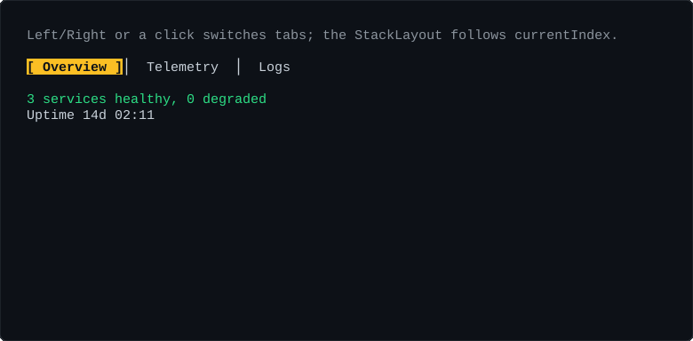

# StackLayout QML type

A container that shows exactly one of its children at a time, chosen by index, and sizes it to fill the layout. [More...](#detailed-description)

| | |
| :--- | :--- |
| **Import Statement** | `import QmlTui` |
| **Since** | QmlTui 0.4 |
| **Inherits** | [Item](item.md) |

## Properties

| Property | Type | Default | Description |
| :--- | :--- | :--- | :--- |
| `currentIndex` | `int` | `0` | Holds the index of the visible child; an index outside the range of children hides every child. |
| `count` | `int` |  | Read-only. Holds the number of children; it follows the `children` list as children are added or removed. |

## Detailed Description

StackLayout is a layout container built on [Item](item.md). Whenever
`currentIndex`, `width`, `height`, padding, or `children` changes, it walks its
`children` in declaration order, sets `visible` to true on the child at
`currentIndex` and false on all others, and positions the current child inside
the layout's padded content area. Its `implicitWidth` and `implicitHeight`
follow the active child's implicit size plus padding. Hidden children keep
whatever geometry they had. Because only the current child is shown and it
always fills the layout, children can be declared with no geometry of their
own.

`count` and the layout follow the `children` list: a page created later, for
example with `Component.createObject(layout)`, is counted and hidden or shown
and sized according to `currentIndex` as soon as it is added, and a destroyed
page is dropped. Bind `currentIndex` to a [TabBar](tabbar.md)'s
`currentIndex` for tabbed pages; use [StackView](stackview.md) when pages are
pushed and popped at run time instead of chosen by index.

StackLayout switches pages instantly and does not move keyboard focus. It is
the natural partner of [TabBar](tabbar.md), whose `currentIndex` can be
bound to it. Use [StackView](stackview.md) for push and pop navigation where
pages are created on demand.

### Example

```qml
import QtQml
import QmlTui
import QmlTui.Controls

Terminal {
    Column {
        anchors.fill: parent
        spacing: 1

        TabBar {
            id: tabs
            width: parent.width
            focus: true
            tabs: ["Status", "Actions"]
        }

        StackLayout {
            width: parent.width
            height: 6
            currentIndex: tabs.currentIndex

            Panel {
                title: Text { text: "Status" }
                Text { x: 2; y: 1; text: "All services healthy." }
            }

            Panel {
                title: Text { text: "Actions" }
                Button { x: 2; y: 1; text: "Quit"; onClicked: Qt.quit() }
            }
        }
    }
}
```

### Interactive Demo & Recording



- **Live Playground**: [▶ Open `TabBar.qml` in the WebAssembly Playground](../playground.md?example=TabBar.qml)
- **Standalone CLI**: `./build/examples/gallery/qmltui_gallery --example TabBar`
- **Gallery Source**: [`examples/gallery/examples/TabBar.qml`](../../examples/gallery/examples/TabBar.qml)
