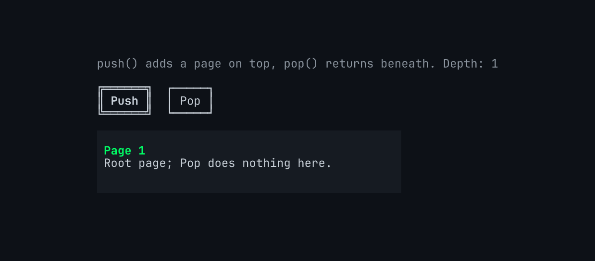

# StackView QML type

A navigation stack that shows only its topmost page and creates pages on demand from URLs, components or items. [More...](#detailed-description)

| | |
| :--- | :--- |
| **Import Statement** | `import QmlTui.Controls` |
| **Since** | QmlTui 0.4 |
| **Inherits** | [Item](item.md) |

## Properties

| Property | Type | Default | Description |
| :--- | :--- | :--- | :--- |
| `currentItem` | `alias` |  | Read-only. Holds the page on top of the stack, or `null` when the stack is empty. |
| `depth` | `int` |  | Read-only. Holds the number of pages on the stack; `push()`, `pop()` and `clear()` keep it current. |

## Methods

| Method | Description |
| :--- | :--- |
| `var push(var itemOrUrl, var properties)` | Creates or adopts a page from a QML file URL string, a `Component` or an existing `Item`, applies `properties`, hides the previous top, and returns the new page or `null` on failure. |
| `var pop()` | Removes the top page, destroying it if the view created it and hiding it otherwise, and shows the one beneath, returning that page; returns `null` without popping when the stack holds one page or none. |
| `var clear()` | Removes every page, destroying the ones the view created and hiding the rest, and sets `currentItem` to `null`. |

## Detailed Description

StackView is written in QML on top of [Item](item.md). It holds its pages in
an inner container that fills the view; `push()` accepts either a URL string,
which is loaded with `Qt.createComponent()` and must be ready synchronously,
a `Component` created with `createObject()`, or an already existing `Item`,
which is reparented into the view. The optional `properties` object is passed
to `createObject()` for the first two forms and ignored for an existing item.
Each pushed page is moved to (0, 0) and resized to the view's `width` and
`height`, and the view keeps the current page at that size when it is
resized. The previous top page is hidden, not destroyed.

`pop()` removes the topmost page and reveals and resizes the page below it.
A page the view created from a URL or a `Component` is destroyed; a page that
was pushed as an existing `Item` is only hidden and stays owned by whoever
created it. The bottom page can
never be popped; call `clear()` to empty the stack entirely. Pages are
switched instantly, with no transition, and StackView does not move keyboard
focus; set `focus` on a control inside the new page if it should receive
input.

`depth` follows the stack: every `push()`, `pop()` and `clear()` updates it,
so bindings such as a "Back" button's `visible: stack.depth > 1` work. Use
[StackLayout](stacklayout.md) instead when all pages exist up front and are
chosen by index, for example from a [TabBar](tabbar.md).

### Example

```qml
import QtQml
import QmlTui
import QmlTui.Controls

Terminal {
    StackView {
        id: pages
        anchors.fill: parent
        Component.onCompleted: push(homePage)
    }

    Component {
        id: homePage
        Column {
            spacing: 1
            Button { text: "Open details"; focus: true
                     onClicked: pages.push(detailPage, { label: "Details" }) }
            Button { text: "Quit"; onClicked: Qt.quit() }
        }
    }

    Component {
        id: detailPage
        Panel {
            property string label: ""
            title: label
            Button { x: 2; y: 1; text: "Back"; focus: true; onClicked: pages.pop() }
        }
    }
}
```

### Interactive Demo & Recording



- **Live Playground**: [▶ Open `StackView.qml` in the WebAssembly Playground](../playground.md?example=StackView.qml)
- **Standalone CLI**: `./build/examples/gallery/qmltui_gallery --example StackView`
- **Gallery Source**: [`examples/gallery/examples/StackView.qml`](../../examples/gallery/examples/StackView.qml)
