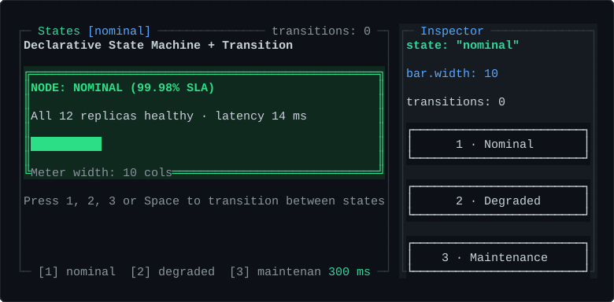

# State QML type

Defines a named visual configuration of an item. [More...](#detailed-description)

| | |
| :--- | :--- |
| **Import Statement** | `import QmlTui` |
| **Since** | QmlTui 0.4 |
| **Inherits** | none |

## Properties

| Property | Type | Default | Description |
| :--- | :--- | :--- | :--- |
| `name` | `string` | `""` | Holds the unique name identifying this state. |
| `when` | `bool` | `false` | Holds a condition expression that automatically activates this state when true. |
| `changes` | `list<QtObject>` |  | Read-only. Holds the list of changes applied when entering this state. This is the default property. |

## Detailed Description

State describes an alternative visual appearance or configuration of an item.
Within a State, one or more [PropertyChanges](propertychanges.md) objects define
the property values applied to target items while this state is active.

States can be activated explicitly by assigning the item's `state` string property,
or declaratively using the `when` condition. Transitions between states can be
animated using [Transition](transition.md). Direct property assignments on
`PropertyChanges` and full QML binding suspension/restoration require
`QMLTUI_ENABLE_PRIVATE_QT=ON`; see [PropertyChanges](propertychanges.md) for the
portable `properties: ({ ... })` fallback syntax.

### Example

<<< ../../examples/gallery/examples/States.qml{qml}

### Gallery Example

See [`examples/gallery/examples/States.qml`](../../examples/gallery/examples/States.qml) (`./build/examples/gallery/qmltui_gallery --example States`).
