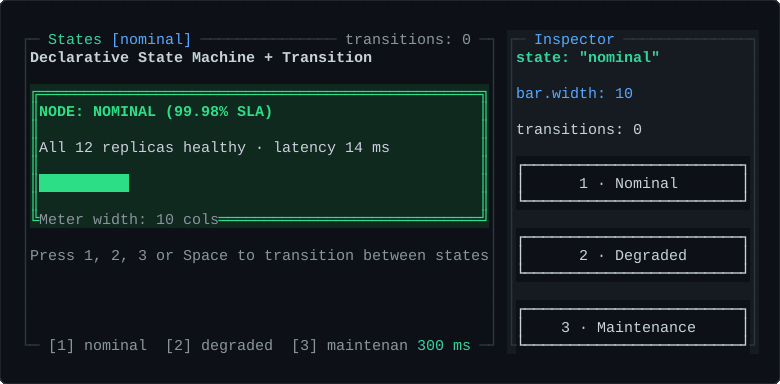

# StateGroup QML type

Provides state and transition management outside of an Item. [More...](#detailed-description)

| | |
| :--- | :--- |
| **Import Statement** | `import QmlTui` |
| **Since** | QmlTui 0.4 |
| **Inherits** | none |

## Properties

| Property | Type | Default | Description |
| :--- | :--- | :--- | :--- |
| `state` | `string` | `""` | Holds the name of the currently active state. |
| `states` | `list<State>` |  | *(default)* Read-only. Holds the list of possible states for this group. |
| `transitions` | `list<Transition>` |  | Read-only. Holds the list of transitions for this group. |

## Detailed Description

StateGroup provides a way to define states and transitions independently of an
Item. This allows state-driven visual modifications across multiple items or
within non-visual components.

StateGroup uses the same internal state controller as Item, honoring `when`
conditions, independent ownership tracking, atomic collision preflight, and
restoration behavior.

### Example

<<< ../../examples/gallery/examples/States.qml{qml}

### Gallery Example

See [`examples/gallery/examples/States.qml`](../../examples/gallery/examples/States.qml) (`./build/examples/gallery/qmltui_gallery --example States`).
