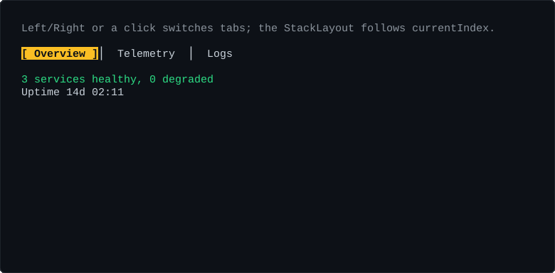

# TabBar QML type

A one-row strip of named tabs selected with the Left and Right keys or the mouse. [More...](#detailed-description)

| | |
| :--- | :--- |
| **Import Statement** | `import QmlTui.Controls` |
| **Since** | QmlTui 0.4 |
| **Inherits** | [Item](item.md) |

## Properties

| Property | Type | Default | Description |
| :--- | :--- | :--- | :--- |
| `selectionColor` | `color` | `QmlTui.invalidColor` | Holds the background colour of the selected tab; when both it and `selectedTextColor` are unset (`QmlTui.invalidColor`), the selected tab is drawn in reverse video instead. |
| `selectedTextColor` | `color` | `QmlTui.invalidColor` | Holds the text colour of the selected tab; falls back to `textColor` when unset. |
| `color` | `color` | `"default"` | Holds the background colour of unselected tabs and separators, where `"default"` is the terminal's own background. |
| `textColor` | `color` | `"default"` | Holds the text colour of unselected tabs and separators, where `"default"` is the terminal's own foreground. |
| `tabs` | `var` |  | Holds the tab labels as a JavaScript array of strings or a string list; other array elements are converted with their string form. |
| `currentIndex` | `int` | `0` | Holds the index of the selected tab, clamped to the range of `tabs`; a value set before `tabs` is assigned is kept and clamped once the tabs arrive, and a list that shrinks clamps it as well. |

## Detailed Description

TabBar draws its `tabs` left to right on a single row. The selected tab is
rendered bold as `[ Name ]` (and underlined while `activeFocus` is true) and
every other tab as `  Name  `, with a `│` separator between neighbours. When
neither `selectionColor` nor `selectedTextColor` is set the selected tab uses
the terminal's reverse-video attribute, so it stays legible under any theme;
setting either colour turns reverse video off and uses the given colours, with
the unset one falling back to `color` or `textColor`. Tabs that do not fit
within `width` are not drawn, and the whole bar is dimmed while the item is
disabled.

TabBar is focusable (`focusPolicy: Qt.StrongFocus`). While it has focus, Left and Right move `currentIndex`
by one and accept the key; the index is clamped at both ends and does not
wrap. A mouse press gives the bar focus and selects the tab under the pointer,
using the same 4-cell padding plus 1-cell separator layout as the painter.
`currentIndexChanged()` is the only notification of a selection; there is no
separate activation signal.

`implicitHeight` is `1` and `implicitWidth` is computed dynamically from `tabs`
(`0` when empty, otherwise the exact sum of padded tab labels plus `│`
separators), so a `TabBar` inside a `Row` or `RowLayout` sizes to fit its tabs
automatically. TabBar has no border; wrap it in a [Rectangle](rectangle.md) or
[Panel](panel.md) when one is needed. Bind `currentIndex` to a
[StackLayout](stacklayout.md) to switch pages with the tabs.

### Example

<<< ../../examples/gallery/examples/TabBar.qml{qml}

### Gallery Example

See [`examples/gallery/examples/TabBar.qml`](../../examples/gallery/examples/TabBar.qml) (`./build/examples/gallery/qmltui_gallery --example TabBar`).
