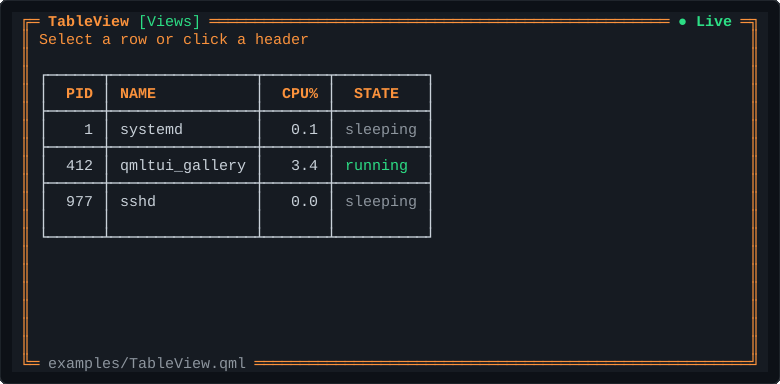

# TableView QML type

Displays tabular models with aligned cells, custom delegates, and connected terminal borders. [More...](#detailed-description)

| | |
| :--- | :--- |
| **Import Statement** | `import QmlTui` |
| **Since** | QmlTui 0.4 |
| **Inherits** | [Item](item.md) |

## Properties

| Property | Type | Default | Description |
| :--- | :--- | :--- | :--- |
| `columns` | `list<var>` | `[]` | List of column descriptors: `{ title, key, role, width, stretch, align, headerAlign, padding, leftPadding, rightPadding, color, background }`. |
| `model` | `var` |  | Holds the data model providing tabular entries: 2D array, TableModel, or QAbstractItemModel. |
| `selectedRow` | `int` | `-1` | Holds the index of the currently selected row, or -1 if no row is selected. |
| `currentColumn` | `int` | `-1` | Holds the index of the currently active column. |
| `alternatingRows` | `bool` | `false` | Whether alternating rows use alternatingRowBackgroundColor. |
| `stretchLastColumn` | `bool` | `false` | Automatically stretch the last column to fill remaining interior width. |
| `headerColor` | `color` | `"default"` | Holds the foreground text color used for column headers. |
| `headerBackgroundColor` | `color` | `"transparent"` | Holds the background color used for column headers. |
| `selectionColor` | `color` | `QmlTui.invalidColor` | Holds the background highlight color for the selected row (unset defaults to reverse video). |
| `selectedTextColor` | `color` | `QmlTui.invalidColor` | Holds the foreground text color for the selected row (unset defaults to reverse video). |
| `selectionKeepsCellColors` | `bool` | `false` | Keep the model's own foreground and background on the selected row, so a table whose colours carry meaning does not lose them on the row being inspected. |
| `textColor` | `color` | `"default"` | Holds the default text color for data cells. |
| `rowBackgroundColor` | `color` | `"transparent"` | Holds the default background color for table rows. |
| `alternatingRowBackgroundColor` | `color` | `"default"` | Holds the background color for alternating table rows. |
| `gridColor` | `color` |  | Color used for borders and grid lines; falls back to `textColor`. |
| `showColumnGrid` | `bool` | `false` | Whether to draw column separators. |
| `showRowGrid` | `bool` | `false` | Draw dividers between visible data rows. |
| `showOuterBorder` | `bool` | `false` | Draw a connected outer frame at the view bounds. |
| `gridStyle` | `GridStyle` | `TableView.Single` | Style of all borders and grid lines: `TableView.Single`, `TableView.Double`, or `TableView.Ascii`. |
| `columnWidthProvider` | `var` |  | Optional JS callback (column) => width returning cell count per column. |
| `cellFormat` | `var` |  | JS callback `(row, column, value) => span \| list<span> \| { text, spans, color, backgroundColor, bold, dim, italic, underline, reversed, align, padding, leftPadding, rightPadding }`. |
| `delegate` | `Component` |  | Holds an optional custom component for rendering cells. |

## Signals

| Signal | Description |
| :--- | :--- |
| `rowActivated(int index)` | Emitted when a row is activated by pressing Enter, Space, or clicking. |
| `headerClicked(int column)` | Emitted when a column header is clicked. |

## Methods

| Method | Description |
| :--- | :--- |
| `void forceLayout()` | Recalculates column widths, layout geometry, and visible rows immediately. |

## Enumeration TableView.GridStyle

| Value | Description |
| :--- | :--- |
| `TableView.Single` | Draws connected borders and grid separators using single-line box-drawing characters (`┌`, `┬`, `┼`, `─`, `│`). |
| `TableView.Double` | Draws connected borders and grid separators using double-line box-drawing characters (`╔`, `╦`, `╬`, `═`, `║`). |
| `TableView.Ascii` | Draws connected borders and grid separators using ASCII characters (`+`, `-`, `|`). |

## Detailed Description

`showColumnGrid`, `showRowGrid`, and `showOuterBorder` are independent and default
to `false`. Its inherited [Item](item.md) `focusPolicy` defaults to `Qt.StrongFocus`.
Enable all three grid flags for a complete box-art table. The header underline
is always present when a header is shown. `gridStyle` accepts `TableView.Single`,
`TableView.Double`, and `TableView.Ascii`. Structural lines, including the header underline, use `gridColor` (falling back to `textColor`)
and the terminal background; `headerColor` applies to heading text only.

### Columns and sizing

Column `width` and `columnWidthProvider` results count content cells, including
padding, **excluding** separators. Each column separator adds one cell; a frame
adds two cells to the total width. Width zero hides a column. Fixed columns
neither stretch to fill unused space nor wrap; excess content is clipped.
Model-defined columns without descriptors or a width provider divide the
interior width after reserving separator cells.

`align` sets cell and header alignment (`"left"`, `"center"`, or `"right"`).
`headerAlign` overrides only the heading, allowing centered headings over
left-aligned data. Padding remains inside the content width.

### Column colours

`color` and `background` let the view say how a column looks, instead of the
model carrying `Qt::ForegroundRole` for every cell. Either takes a colour:

```qml
columns: [
    { title: "Time", width: 14, color: "#8a94a6" },
    { title: "Rate", width: 8, align: "right", color: "#ffb86c" },
]
```

A column that states a colour uses it for every cell and the matching role is
not read at all, so this costs nothing per cell.

Either may instead be a function, called per cell as `(row, column, value)` and
returning a colour, for a column whose ink depends on the row:

```qml
{ title: "Time", width: 14,
  color: (row) => model.isError(row) ? "#dc4c4c" : "#8a94a6" }
```

A function that returns nothing leaves the cell to the model's role, so a view
can decide some rows and defer on the rest. Returned colours are parsed once
and reused, so repeating a handful of values across many cells is cheap.

A column colour wins over `Qt::ForegroundRole` and `Qt::BackgroundRole`: those
roles are the compatibility path for models ported from Qt Widgets, and an
explicit view-side rule outranks them. `cellFormat` still runs afterwards and
overrides both. Neither applies to a selected row unless
`selectionKeepsCellColors` is set.

A frame reserves one line at the top and bottom. A header reserves two interior
lines. Data rows are one line tall, with one extra line **between** visible rows
when `showRowGrid` is enabled. There is no trailing row divider. Empty space
below the data remains inside the frame and keeps its column separators. Five body lines fit three rows and two
dividers; four body lines fit two rows, one divider, and one unused line.

Zero-sized views draw nothing. A one-cell-wide or one-cell-high frame becomes a
straight line; a `1×1` frame becomes a cross. Headers and content are clipped to
the remaining interior.

The implicit width is the sum of the visible column widths plus separator and
frame cells, so a `TableView` inside a `Row` or `Column` sizes itself to its
columns. The implicit height is `0`: give the view a `height` or anchors, or it
draws nothing.

### Delegates and interaction

Cell delegates receive one content rectangle. The view owns their geometry and
clips each subtree to one line, retaining connected borders and row dividers.
Selection and alternating row backgrounds fill the full interior row width
(including any unused width to the right of the last column) while leaving
structural grid and border lines intact.

Header content clicks emit `headerClicked`. Data content clicks select and
activate the corresponding model row. Borders, separators, header underlines,
and empty body space are not activation targets. Up/Down move one row;
PageUp/PageDown move by the number of visible data rows.

The viewport is remembered rather than derived from the selection: moving the
selection within the visible rows does not scroll, and the view moves only far
enough to bring the selection back into range when it would fall outside. A
view that has not been scrolled stays at the top, so rows inserted above it
become visible instead of pushing it down; once scrolled, the top line keeps
showing the same row even as rows are added or removed above it. Resizing and
grid changes keep the selected row visible whenever a row fits.

This API replaces `showGrid` with `showColumnGrid`; there is no compatibility
alias in QML or C++. Widths no longer include separators, and the view no longer
has a built-in `40×10` implicit size.

### Example

<<< ../../examples/gallery/examples/TableView.qml{qml}

### Gallery Example



See [`examples/gallery/examples/TableView.qml`](../../examples/gallery/examples/TableView.qml) (`./build/examples/gallery/qmltui_gallery --example TableView`).
