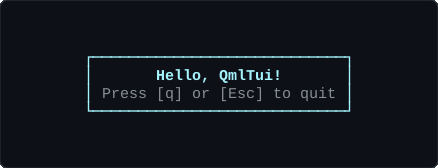

# Terminal QML type

Root element for QmlTui terminal applications, managing session lifecycle, screen buffers, and input. [More...](#detailed-description)

| | |
| :--- | :--- |
| **Import Statement** | `import QmlTui` |
| **Since** | QmlTui 0.4 |
| **Inherits** | [Item](item.md) |

## Properties

| Property | Type | Default | Description |
| :--- | :--- | :--- | :--- |
| `capabilities` | `terminalCapabilities` |  | Read-only. Holds detected terminal capabilities such as Kitty graphics and synchronized output support. |
| `title` | `string` | `""` | Holds the terminal window title bar string set via OSC 2 escape sequence. |
| `color` | `color` | `"transparent"` | Holds the root background color of the terminal screen. |
| `mode` | `Mode` | `Terminal.AltScreen` | Holds the display mode: `Terminal.AltScreen` (alternate screen) or `Terminal.Inline` (normal buffer). |
| `clipboardMode` | `ClipboardMode` | `Terminal.Osc52` | Holds the clipboard integration mode: `Terminal.Osc52` or `Terminal.Disabled`. |
| `mouseReporting` | `bool` |  | Whether the application takes the mouse from the terminal: on in `AltScreen`, off in `Inline` unless set explicitly, in which case the value sticks across mode changes. Off means no clicks, drags, wheel or hover reach any item and the terminal keeps selection and scrollback; hover requests (`MouseArea.hoverEnabled`, `ToolTip`) only turn on motion reporting while this is true. |
| `hoveredItem` | `Item` |  | Read-only. Holds the item currently under the mouse pointer. |
| `terminalWidth` | `int` |  | Read-only. Holds the host terminal screen width in columns. |
| `terminalHeight` | `int` |  | Read-only. Holds the host terminal screen height in rows. |
| `applicationActive` | `bool` | `true` | Read-only. Whether the terminal window currently holds host focus (updated via DECSET 1004 focus-in/out events). |
| `progress` | `real` | `0.0` | Progress value (`0.0`–`1.0`) for OSC 9;4 terminal progress reporting. |
| `progressState` | `ProgressState` | `Terminal.ProgressNone` | Holds the OSC 9;4 progress indicator state (`ProgressNone`, `ProgressNormal`, `ProgressError`, `ProgressIndeterminate`, or `ProgressWarning`). |

## Signals

| Signal | Description |
| :--- | :--- |
| `clipboardCopyRequested(string text)` | Emitted for every copy request, including when clipboard output is disabled. |
| `focusedItemChanged()` | Emitted when the currently focused item changes. |
| `mouseMotionRequestedChanged(bool requested)` | Emitted when items request or release mouse motion tracking. |

## Methods

| Method | Description |
| :--- | :--- |
| `void copyToClipboard(string text)` | Copies text to the system clipboard using the configured clipboardMode. |
| `void bell()` | Emits an audible or visual terminal bell (`BEL`, `\x07`) to the host terminal. |
| `void queryColors()` | Re-queries the host terminal's default foreground (`OSC 10`), default background (`OSC 11`), and 16 ANSI palette colors (`OSC 4;0..15`), emitting `capabilitiesChanged()` as replies arrive. Also invoked automatically when the terminal reports a palette change via DEC mode `2031` (`CSI ? 997 ; 1 n` / `CSI ? 997 ; 2 n`). |

## Enumeration Terminal.Mode

| Value | Description |
| :--- | :--- |
| `Terminal.AltScreen` | Fills the entire terminal window using the alternate screen buffer. |
| `Terminal.Inline` | Operates within the normal terminal buffer, sizing to content height. |

## Enumeration Terminal.ClipboardMode

| Value | Description |
| :--- | :--- |
| `Terminal.Disabled` | Disables terminal clipboard escape sequence integration. |
| `Terminal.Osc52` | Enables OSC 52 clipboard writes and explicit asynchronous reads through [Clipboard](clipboard.md). |

## Enumeration Terminal.ProgressState

| Value | Description |
| :--- | :--- |
| `Terminal.ProgressNone` | Hides the terminal progress indicator (`0`). |
| `Terminal.ProgressNormal` | Displays normal progress using `progress` (`1`). |
| `Terminal.ProgressError` | Displays error progress state using `progress` (`2`). |
| `Terminal.ProgressIndeterminate` | Displays an indeterminate pulsing progress indicator (`3`). |
| `Terminal.ProgressWarning` | Displays paused or warning progress state using `progress` (`4`). |

## Detailed Description

Terminal is the required root item of every QmlTui application. It establishes
the retained-mode rendering pipeline, handles terminal capability detection,
coordinates keyboard and mouse event routing, and manages the terminal screen mode.

In `AltScreen` mode, the application switches to the terminal's alternate screen
buffer, clears the screen, and renders frames across the full terminal grid dimensions.
In `Inline` mode, the application renders inside the normal buffer with content-driven
height, leaving preceding terminal scrollback intact.

Terminal does not automatically bind Q or Escape to quit; applications should provide
an explicit keyboard quit path using [Keys](keys.md) or [Shortcut](shortcut.md).

### Example

```qml
import QtQml
import QmlTui

Terminal {
    title: "QmlTui App"
    color: "#0f172a"

    Keys.onPressed: event => {
        if (event.key === Qt.Key_Q || event.key === Qt.Key_Escape) {
            Qt.quit()
            event.accepted = true
        }
    }

    Text {
        anchors.centerIn: parent
        text: "Welcome to QmlTui (Press Q to quit)"
        color: "cyan"
    }
}
```

The [Clipboard singleton](clipboard.md) provides `copy(text)` and Promise-based
`requestText()` with automatic terminal selection. Normal terminal-initiated
paste arrives through input handling independently of clipboard queries.

### Recorded Example



See [`examples/helloworld/`](../../examples/helloworld/) and [`examples/gallery/Main.qml`](../../examples/gallery/Main.qml).
