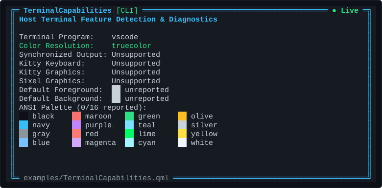

# terminalCapabilities Value type

Describes capabilities detected from the host terminal environment. [More...](#detailed-description)

| | |
| :--- | :--- |
| **Import Statement** | `import QmlTui` |
| **Since** | QmlTui 0.4 |
| **Inherits** | none |
| **Instantiation** | Value type, not instantiable |

## Properties

| Property | Type | Default | Description |
| :--- | :--- | :--- | :--- |
| `kittyKeyboard` | `bool` |  | Read-only. Holds whether the terminal supports the Kitty keyboard protocol with key disambiguation. |
| `kittyGraphics` | `bool` |  | Read-only. Holds whether the terminal supports true-pixel graphics via the Kitty graphics protocol. |
| `sixelGraphics` | `bool` |  | Read-only. Holds whether the terminal supports raster graphics via the Sixel protocol. |
| `cellPixelSize` | `size` |  | Read-only. Holds the pixel dimensions (width x height) of a single character cell, or invalid if unknown. |
| `syncOutput` | `bool` |  | Read-only. Holds whether the terminal supports synchronized output (DEC private mode 2026) for tear-free frame updates. |
| `colorDepth` | `string` |  | Read-only. Holds the detected colour resolution name: `"mono"`, `"16"`, `"256"`, or `"truecolor"`. |
| `termProgram` | `string` |  | Read-only. Holds the terminal program name if advertised (e.g. `"kitty"`, `"iTerm.app"`, `"wezterm"`). |
| `isTty` | `bool` |  | Read-only. Holds whether standard output is connected to an interactive terminal rather than a pipe or file. |
| `defaultForegroundColor` | `color` | invalid | Read-only. Holds the host terminal's default foreground RGB color reported via `OSC 10` on startup, or an invalid `color` (`valid === false`) if unreported. |
| `defaultBackgroundColor` | `color` | invalid | Read-only. Holds the host terminal's default background RGB color reported via `OSC 11` on startup, or an invalid `color` (`valid === false`) if unreported. |
| `ansiPalette` | `list<color>` | 16 invalid entries | Read-only. Holds the 16 ANSI palette colors (`0`–`15`) reported via `OSC 4` after `Terminal.queryColors()` is called, with unreported slots left invalid (`valid === false`). |

## Methods

| Method | Description |
| :--- | :--- |
| `color ansiColor(int index)` | Returns the queried RGB color for ANSI palette index `0`–`15`, or an invalid `color` (`valid === false`) if out of range or unreported by the terminal. |

## Detailed Description

`terminalCapabilities` is a read-only value type exposed through [Terminal.capabilities](terminal.md).
During application startup, QmlTui inspects environment variables (`TERM`, `TERM_PROGRAM`,
`COLORTERM`) and issues asynchronous VT query probes to determine host terminal features.

Applications use these flags to enable rich features conditionally, such as true-pixel
image rendering via Kitty graphics or fine-grained key event detection.

### Example

<<< ../../examples/gallery/examples/TerminalCapabilities.qml{qml}

### Gallery Example

See [`examples/gallery/examples/TerminalCapabilities.qml`](../../examples/gallery/examples/TerminalCapabilities.qml) (`./build/examples/gallery/qmltui_gallery --example TerminalCapabilities`).
