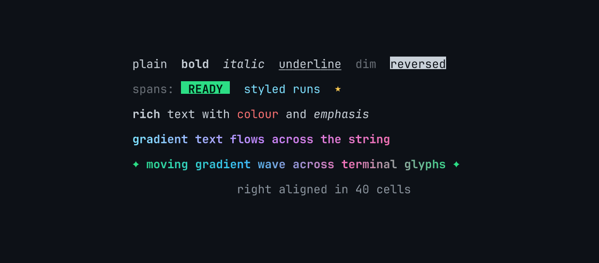

# Text QML type

Displays terminal text with inline styling and explicit line breaks. [More...](#detailed-description)

| | |
| :--- | :--- |
| **Import Statement** | `import QmlTui` |
| **Since** | QmlTui 0.4 |
| **Inherits** | [Item](item.md) |

## Properties

| Property | Type | Default | Description |
| :--- | :--- | :--- | :--- |
| `spans` | `list<span>` | `[]` | Literal styled runs; a nonempty list takes precedence over `text`. |
| `text` | `string` | `""` | Holds the plain, rich, or ANSI text to display when `spans` is empty. |
| `color` | `rgba` | `"default"` | Holds the text foreground color. |
| `backgroundColor` | `rgba` | `"transparent"` | Holds the background color of character cells. |
| `bold` | `bool` | `false` | Whether text is rendered in bold face. |
| `dim` | `bool` | `false` | Whether text is rendered in dim or faint face. |
| `italic` | `bool` | `false` | Whether text is rendered in italic face if supported by the terminal. |
| `underline` | `bool` | `false` | Whether text is rendered with an underline. |
| `reversed` | `bool` | `false` | Whether foreground and background colors are inverted. |
| `horizontalAlignment` | `int` | `Qt.AlignLeft` | Holds horizontal alignment: `Qt.AlignLeft`, `Qt.AlignHCenter`, or `Qt.AlignRight`. |
| `verticalAlignment` | `int` | `Qt.AlignTop` | Holds vertical alignment: `Qt.AlignTop`, `Qt.AlignVCenter`, or `Qt.AlignBottom`. |
| `textFormat` | `TextFormat` | `Text.AutoText` | Holds how text is parsed: `Text.PlainText`, `Text.RichText`, `Text.AnsiText`, or `Text.AutoText`. |
| `wrapMode` | `WrapMode` | `Text.NoWrap` | Holds text wrapping mode: `Text.NoWrap`, `Text.WordWrap`, `Text.WrapAnywhere`, or `Text.Wrap`. |
| `gradient` | `Gradient` | `null` | Holds an optional [Gradient](gradient.md) applied across the rendered text characters. |

## Signals

| Signal | Description |
| :--- | :--- |
| `linkActivated(string link)` | Emitted when an embedded hyperlink tag or markdown link is clicked. |

## Enumeration Text.TextFormat

| Value | Description |
| :--- | :--- |
| `Text.PlainText` | Text is treated as plain literal text without formatting interpretation. |
| `Text.RichText` | Basic HTML tags (such as `<b>`, `<i>`, `<font color="...">`, `<a href="...">`) are parsed. |
| `Text.AnsiText` | Embedded ANSI/VT SGR escape sequences are parsed and styled. |
| `Text.AutoText` | Automatically determines format based on presence of HTML tags, markdown links, or ANSI escape codes. |

## Enumeration Text.WrapMode

| Value | Description |
| :--- | :--- |
| `Text.NoWrap` | Text is not wrapped; explicit line breaks are preserved. |
| `Text.WordWrap` | Text is wrapped at word boundaries when width is exceeded. |
| `Text.WrapAnywhere` | Text is wrapped at any character boundary when width is exceeded. |
| `Text.Wrap` | Text is wrapped at word boundaries when possible, or at any character boundary. |

## Detailed Description

`Text` caches glyphs and line layouts. Newlines start lines; content does not
wrap automatically by default (`Text.NoWrap`), and wraps when `wrapMode` is set
to `Text.WordWrap`, `Text.WrapAnywhere`, or `Text.Wrap`. `implicitWidth` is the widest line in terminal cells and
`implicitHeight` counts lines, including consecutive and trailing empty lines.
Horizontal alignment applies per line; vertical alignment positions the whole
block. Content outside the available dimensions is clipped.

A nonempty `spans` list renders [span](span.md) values in sequence. Adjacent
spans continue on the same line, and a span can contain multiple lines. Clearing
`spans` restores the current `text`; `[ { text: "" } ]` renders empty content
instead. Changing either property updates the implicit dimensions.

Span content is literal: `textFormat` only affects `text`, and HTML/ANSI markup
is not interpreted in spans. Control characters use the existing sanitized
Unicode rendering behavior. Graphemes are segmented across span boundaries;
a combined character or emoji uses the style of the span containing its first
UTF-16 code unit.

Omitted span colors and attributes inherit the Text foreground and attributes.
Explicit `false` disables an inherited attribute. Explicit `color: "default"`
requests terminal-default foreground even when Text has another color.
Background defaults to transparent. An active gradient overrides all glyph
foregrounds, including explicit span colors. Effective disabled state adds dim
at paint time, including to spans that explicitly set `dim: false`.

### Example

```qml
pragma ComponentBehavior: Bound
import QtQml
import QmlTui

Terminal {
    Text {
        color: "cyan"
        bold: true
        spans: [
            { text: "Status: ", dim: true, bold: false },
            QmlTui.span("Active\n", { color: "green" }),
            { text: "Workers: 4" }
        ]
    }
    Keys.onPressed: event => {
        if (event.key === Qt.Key_Q || event.key === Qt.Key_Escape) {
            Qt.quit()
            event.accepted = true
        }
    }
}
```

### C++

Use `qmltui::Text` from `<QmlTui/Core/Items/Text.h>`. Construct it with an optional parent
`QObject`, set properties directly, and use `paint()` during the text grid
render pass.

### Interactive Demo & Recording



- **Live Playground**: [▶ Open `Text.qml` in the WebAssembly Playground](../playground.md?example=Text.qml)
- **Standalone CLI**: `./build/examples/gallery/qmltui_gallery --example Text`
- **Gallery Source**: [`examples/gallery/examples/Text.qml`](../../examples/gallery/examples/Text.qml)
