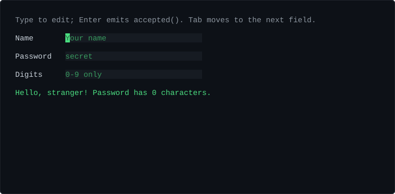

# TextInput QML type

A single-line editable text input item for terminal applications. [More...](#detailed-description)

| | |
| :--- | :--- |
| **Import Statement** | `import QmlTui` |
| **Since** | QmlTui 0.4 |
| **Inherits** | [Item](item.md) |

## Properties

| Property | Type | Default | Description |
| :--- | :--- | :--- | :--- |
| `text` | `string` | `""` | Holds the plain text entered in the input field. |
| `color` | `color` | `"default"` | Holds the foreground color of the entered text. |
| `placeholderText` | `string` | `""` | Holds the hint text displayed when `text` is empty. |
| `placeholderColor` | `color` |  | Holds the color used to draw `placeholderText`. |
| `displayText` | `string` |  | Read-only. Holds the text currently rendered on screen, reflecting `echoMode`. |
| `overwriteMode` | `bool` | `false` | Whether typed characters overwrite existing text at the cursor instead of being inserted. |
| `autoScroll` | `bool` | `true` | Whether the view automatically scrolls horizontally to follow cursor movement. |
| `cursorPosition` | `int` | `0` | Holds the current character index of the cursor within `text`. |
| `selectionStart` | `int` | `0` | Read-only. Holds the starting character index of the current text selection. |
| `selectionEnd` | `int` | `0` | Read-only. Holds the ending character index of the current text selection. |
| `selectedText` | `string` | `""` | Read-only. Holds the text currently selected. |
| `readOnly` | `bool` | `false` | Whether text editing is disabled. |
| `contentX` | `int` | `0` | Holds the horizontal scroll offset in character cells. |
| `maximumLength` | `int` | `0` | Holds the maximum number of characters allowed in `text` (`0` means no limit). |
| `validator` | `QRegularExpression` |  | Holds a regular expression used to validate acceptable input. |
| `acceptableInput` | `bool` |  | Read-only. Whether the current `text` satisfies `validator`. |
| `echoMode` | `EchoMode` | `TextInput.Normal` | Holds the display mode for entered characters: `Normal`, `Password`, or `NoEcho`. |
| `echoCharacter` | `string` | `"*"` | Holds the masking character displayed when `echoMode` is `Password`. |
| `cursorShape` | `CursorShape` | `TextInput.Block` | Holds the visual shape of the cursor: `Block`, `Underline`, `Beam`, or `HollowBlock`. |
| `cursorColor` | `color` | `"default"` | Holds the color of the text cursor. |
| `cursorBlinking` | `bool` | `false` | Whether the cursor blinks periodically while the item has focus. |
| `cursorBlinkRate` | `int` | `500` | Holds the cursor blinking interval in milliseconds. |
| `cursorVisible` | `bool` | `true` | Whether the cursor is visible when the item has focus. |
| `cursorDelegate` | `string` | `""` | Holds an optional custom character glyph used to render the cursor. |
| `selectionColor` | `color` |  | Holds the background highlight color for selected text. |
| `selectedTextColor` | `color` |  | Holds the foreground text color for selected text. |
| `canUndo` | `bool` |  | Read-only. Whether an undo history entry is available. |
| `canRedo` | `bool` |  | Read-only. Whether a redo history entry is available. |

## Signals

| Signal | Description |
| :--- | :--- |
| `accepted()` | Emitted when the Return or Enter key is pressed. |
| `editingFinished()` | Emitted when Return is pressed or when the item loses active focus. |

## Methods

| Method | Description |
| :--- | :--- |
| `void select(int start, int end)` | Selects characters between character positions `start` and `end`. |
| `void selectAll()` | Selects the entire contents of `text`. |
| `void clearSelection()` | Clears the active selection without modifying the text. |
| `void clear()` | Clears all text and resets `cursorPosition` to `0`. |
| `void copy()` | Copies the currently selected text to the clipboard. |
| `void cut()` | Cuts the currently selected text to the clipboard. |
| `void paste(string text)` | Inserts text at the current cursor position. |
| `void undo()` | Reverts the most recent text editing action. |
| `void redo()` | Reapplies the most recently undone editing action. |

## Enumeration TextInput.EchoMode

| Value | Description |
| :--- | :--- |
| `TextInput.Normal` | Displays characters exactly as typed. |
| `TextInput.Password` | Displays the masking `echoCharacter` in place of entered characters. |
| `TextInput.NoEcho` | Does not display any characters on screen. |

## Enumeration TextInput.CursorShape

| Value | Description |
| :--- | :--- |
| `TextInput.Block` | Renders a full solid rectangular block over the character cell. |
| `TextInput.Underline` | Renders an underline at the bottom of the character cell. |
| `TextInput.Beam` | Renders a vertical line cursor at the left of the cell. |
| `TextInput.HollowBlock` | Renders a hollow rectangular block outline. |

## Detailed Description

TextInput provides a single-line editable text control designed for terminal cell grids.
It handles keyboard cursor movement (Left/Right arrows, Home, End, word navigation with
Control/Alt), character insertion and deletion (Backspace, Delete), mouse click and drag
selection, and clipboard operations.

Input can be constrained using `maximumLength` or a regular expression
`validator`. When `echoMode` is set to `TextInput.Password`, characters are obscured
with `echoCharacter`. The cursor appearance is customizable via `cursorShape`,
`cursorColor`, and `cursorBlinkRate`.

Pressing Enter or Return emits `accepted()` and `editingFinished()`. Losing active
focus also emits `editingFinished()`.

### Example

```qml
import QtQml
import QmlTui

Terminal {
    Keys.onPressed: event => {
        if (event.key === Qt.Key_Q || event.key === Qt.Key_Escape) {
            Qt.quit()
            event.accepted = true
        }
    }

    Column {
        anchors.centerIn: parent
        spacing: 1

        Rectangle {
            width: 30
            height: 3
            border.style: Border.Single

            TextInput {
                id: nameInput
                anchors.fill: parent
                anchors.margins: 1
                placeholderText: "Enter name..."
                focus: true
                onAccepted: greeting.text = "Hello, " + text + "!"
            }
        }

        Text {
            id: greeting
            text: "Type a name and press Enter"
        }
    }
}
```

### Terminal Preview

```text
┌────────────────────────────┐
│Enter name...               │
└────────────────────────────┘

Type a name and press Enter
```

### Gallery Example



See [`examples/gallery/examples/TextInput.qml`](../../examples/gallery/examples/TextInput.qml) (`./build/examples/gallery/qmltui_gallery --example TextInput`, or open in the [WebAssembly Playground](../playground.md?example=TextInput.qml)).
