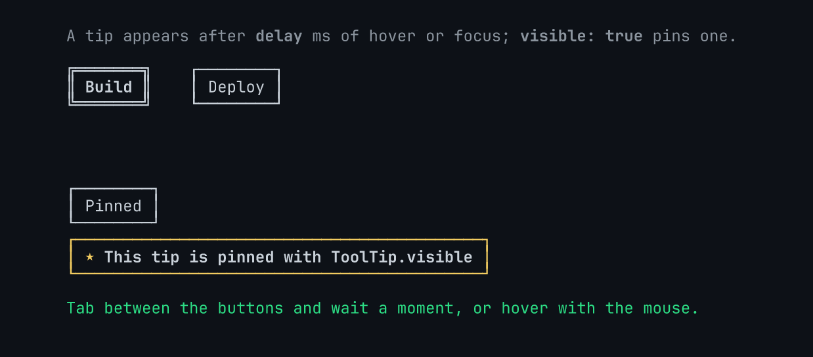

# ToolTip QML type

An attached property that shows a short text box next to an item while it is hovered or focused. [More...](#detailed-description)

| | |
| :--- | :--- |
| **Import Statement** | `import QmlTui.Controls` |
| **Since** | QmlTui 0.4 |
| **Inherits** | none |
| **Instantiation** | Not instantiable; use as an attached property |

## Attached Properties

| Property | Type | Default | Description |
| :--- | :--- | :--- | :--- |
| `background` | `Item` | `Rectangle` | Holds the background item filling the tooltip popup at `z: -1`. |
| `border.color` | `color` | `"default"` | Holds the border colour of the default background [Rectangle](rectangle.md). |
| `border.style` | `enumeration` | `Border.None` | Holds the border style (`Border.None`, `Border.Single`, `Border.Double`, `Border.Rounded`, `Border.Ascii`) of the default background [Rectangle](rectangle.md). |
| `color` | `color` | `"default"` | Holds the background colour of the default tip box, where `"default"` is the terminal's own background. |
| `contentItem` | `Item` | `Text` | Holds the foreground content item displayed inside the tooltip popup. |
| `textColor` | `color` | `"default"` | Holds the colour of the default bold tip text, where `"default"` is the terminal's own foreground. |
| `text` | `string` | `""` | Holds the text to show in the default `contentItem`; an empty string hides the tip unless a custom `contentItem` is provided. |
| `visible` | `bool` | `false` | Holds whether the tip box is currently shown; setting it true shows the tip immediately and keeps it pinned, setting it false hides it and returns to automatic behaviour. |
| `delay` | `int` | `700` | Holds the milliseconds between the item becoming hovered or focused and the tip appearing; negative values are clamped to 0. |
| `timeout` | `int` | `5000` | Holds the milliseconds after which a shown tip hides itself; 0 disables the timeout. |
| `z` | `real` | `1000` | Holds the stacking value of the internal popup relative to other popups. |

## Detailed Description

ToolTip cannot be created as an element; write `ToolTip.text` and the other
properties on any [Item](item.md). The attached object watches its target's
`activeFocus`, `visible` and parent, and the [Terminal](terminal.md)'s
hovered and focused items. The target counts as active while it has active
focus or while the mouse is over it or one of its descendants. When the
target becomes active and `text` is not empty (or a custom `contentItem` is assigned), a single-shot timer of
`delay` milliseconds starts and then shows the tip; when the target stops
being active, the pending timer is cancelled and the tip hides. Having tooltip content
makes the item request mouse-motion reporting so hover can be
detected.

The tip is a non-modal [Popup](popup.md) with `Popup.NoAutoClose`, owned by
the target, containing a `background` item (by default an opaque [Rectangle](rectangle.md))
synchronized with popup dimensions and a `contentItem` (by default a bold [Text](text.md)).
The attached `ToolTip.color` and `ToolTip.border` route directly to the default background
rectangle. When `border.style` is `Border.None` (the default), the content is inset by 1 horizontal space cell on each side (`width = contentWidth + 2`, `height = contentHeight`). When `border.style` is not `Border.None`, the popup expands by 2 border rows vertically and 2 border columns horizontally, placing the content at `(2, 1)`. You can also assign custom `ToolTip.background` and `ToolTip.contentItem` slots just like other `QmlTui.Controls` types. Its default text width is capped at 40 cells or
half the terminal width, whichever is smaller. It is placed directly below
the target, clamped to the terminal horizontally, and flipped above the
target if it would run past the bottom row. While visible it follows the target: layout running
after the tip opened (a pinned tip shows before Row or Column have placed the
target) or the target or an ancestor moving repositions the tip. Opening the popup takes focus only if the popup has a
focusable child, which the tip does not, so the target keeps focus. The tip
hides after `timeout` milliseconds unless `timeout` is 0.

Setting `visible` to true bypasses the delay and hover logic and shows the
tip at once; it is re-shown on every hover or focus change until `visible`
is set back to false. Reparenting the target to another terminal destroys the
internal popup and rebinds the watchers. `visible` reads the popup's actual
state, so after the timeout fires it reports false even when it was set to
true.

### Example

<<< ../../examples/gallery/examples/ToolTip.qml{qml}

### Gallery Example

See [`examples/gallery/examples/ToolTip.qml`](../../examples/gallery/examples/ToolTip.qml) (`./build/examples/gallery/qmltui_gallery --example ToolTip`, or open in the [WebAssembly Playground](../playground.md?example=ToolTip.qml)).
