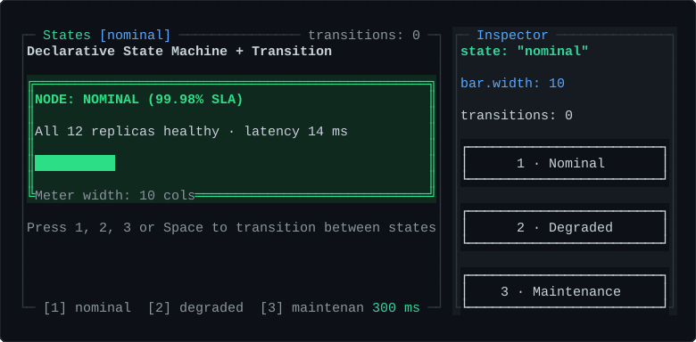

# Transition QML type

Defines animated transitions between states. [More...](#detailed-description)

| | |
| :--- | :--- |
| **Import Statement** | `import QmlTui` |
| **Since** | QmlTui 0.4 |
| **Inherits** | none |

## Properties

| Property | Type | Default | Description |
| :--- | :--- | :--- | :--- |
| `from` | `string` | `"*"` | Holds the origin state name that triggers this transition (`"*"` matches any state). |
| `to` | `string` | `"*"` | Holds the target destination state name that triggers this transition (`"*"` matches any state). |
| `animations` | `list<Animation>` |  | Read-only. Holds the animations played when moving between the states. This is the default property. |

## Detailed Description

Transition specifies the animations that play when an item changes its visual
[State](state.md).

By default, transitions apply in both directions if `from` and `to` are `*`,
or they can be customized for specific state changes (e.g. `from: "off"; to: "on"`).
Animations placed inside the Transition are automatically configured to animate
the properties modified by the state change.

### Example

<<< ../../examples/gallery/examples/States.qml{qml}

### Gallery Example

See [`examples/gallery/examples/States.qml`](../../examples/gallery/examples/States.qml) (`./build/examples/gallery/qmltui_gallery --example States`).
