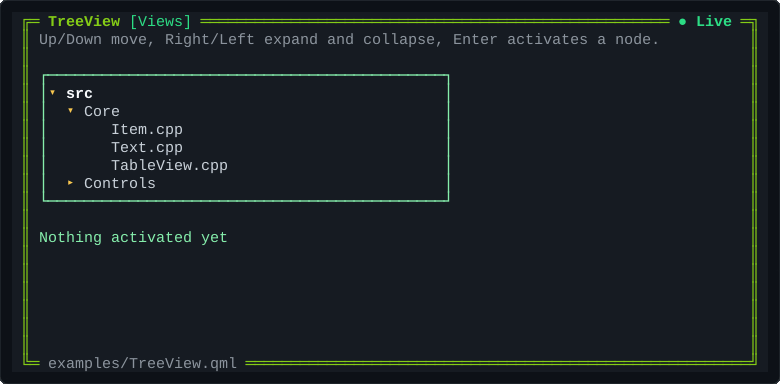

# TreeView QML type

Displays expandable hierarchical model data. [More...](#detailed-description)

| | |
| :--- | :--- |
| **Import Statement** | `import QmlTui` |
| **Since** | QmlTui 0.4 |
| **Inherits** | [Item](item.md) |

## Properties

| Property | Type | Default | Description |
| :--- | :--- | :--- | :--- |
| `model` | `var` |  | Holds the hierarchical data model (`QAbstractItemModel` or nested JavaScript object tree `{ text, children: [...] }`). |
| `rootIndex` | `QModelIndex` |  | Holds the parent index whose children the view shows when using `QAbstractItemModel`. |
| `delegate` | `Component` |  | Holds the component instantiated for each visible tree row. This is the default property. |
| `nodeFormat` | `var` |  | Optional JS callback `(row, value) => span \| list \| { text, spans, color, backgroundColor, bold, dim, italic, underline, reversed }` for built-in painting. |
| `currentIndex` | `int` | `-1` | Holds the index of the currently active tree row. |
| `currentColumn` | `int` | `-1` | Read-only. Holds the current column index (`0` when a row is selected, `-1` when no row is selected). |
| `currentItemData` | `var` |  | Read-only. Holds a dictionary of role data for the currently selected item. |
| `selectionColor` | `color` |  | Holds the text color override for the selected row. |
| `selectionBackgroundColor` | `color` |  | Holds the background color override for the selected row. |
| `textColor` | `color` | `"default"` | Holds the default text color for tree items. |
| `branchColor` | `color` | `"default"` | Holds the color used to draw branch guides and expansion icons. |
| `expandedIcon` | `string` | `"[-] "` | Holds the icon glyph displayed for expanded parent nodes. |
| `collapsedIcon` | `string` | `"[+] "` | Holds the icon glyph displayed for collapsed parent nodes. |

## Signals

| Signal | Description |
| :--- | :--- |
| `nodeActivated(string path)` | Emitted when a tree node is activated with Enter or mouse click. |
| `itemActivated(int index)` | Emitted when a tree row is activated, passing its flat row index. |
| `expanded(int row, int depth)` | Emitted when a tree node is expanded. |
| `collapsed(int row, bool recursively)` | Emitted when a tree node is collapsed. |

## Methods

| Method | Description |
| :--- | :--- |
| `void expand(int index)` | Expands the node at the specified row index. |
| `void collapse(int index)` | Collapses the node at the specified row index. |
| `void toggleExpanded(int index)` | Toggles the expansion state of the node at index. |
| `bool isExpanded(int index)` | Returns whether the node at index is currently expanded. |
| `int depth(int row)` | Returns the hierarchical indentation depth of the node at row. |
| `void expandRecursively(int row, int depth)` | Expands the node at row and its descendants down to the given depth. |
| `void expandRecursively(int row)` | Recursively expands all descendants of the node at row. |
| `void expandRecursively()` | Recursively expands all nodes in the tree. |
| `void collapseRecursively(int row)` | Recursively collapses the node at row and all its descendants. |
| `void collapseRecursively()` | Collapses all nodes in the entire tree. |
| `void expandToIndex(QModelIndex index)` | Expands all ancestor nodes required to reveal the given model index. |
| `void expandAll()` | Expands all nodes in the tree. |
| `void collapseAll()` | Collapses all nodes in the tree. |

## Detailed Description

TreeView displays hierarchical tree data in terminal rows with expandable branch
guides. It supports two data source formats via `model`: a C++ `QAbstractItemModel`
or a nested JavaScript object tree.

Keyboard navigation follows standard tree conventions: Up and Down arrow keys move
the active row; Right arrow expands a collapsed node or enters its first child;
Left arrow collapses an open node or jumps to its parent. Pressing Enter or clicking
emits `itemActivated` and `nodeActivated`.

Nodes are indented according to their `depth`. Branch icons and connectors are
rendered using `branchColor`. In built-in painting (when `delegate` is unset),
nodes may supply a `QmlTui.span(...)` or `list` through `Qt::DisplayRole`,
a `"spans"` role, or a `model` map (`spans`, `text`, or `display`), or format
labels per visible row via `nodeFormat(row, value)`.

### Example

<<< ../../examples/gallery/examples/TreeView.qml{qml}

### Gallery Example

See [`examples/gallery/examples/TreeView.qml`](../../examples/gallery/examples/TreeView.qml) (`./build/examples/gallery/qmltui_gallery --example TreeView`, or open in the [WebAssembly Playground](../playground.md?example=TreeView.qml)).
